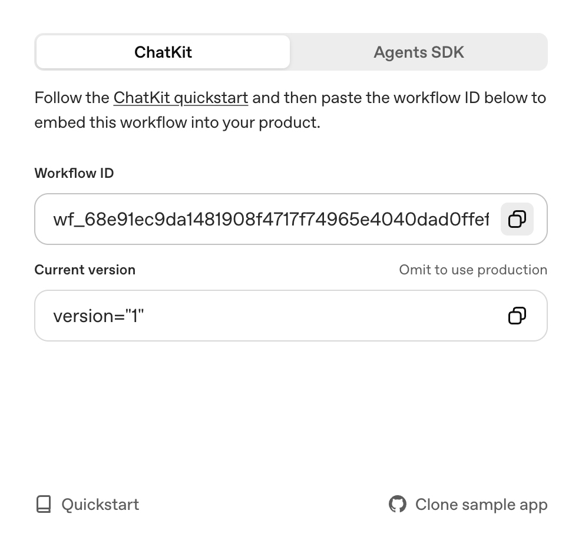

# Msg2AgentBuilder

[](LICENSE)


## What is Msg2AgentBuilder?

Msg2AgentBuilder bridges SMS messaging with AI-powered conversations by connecting **Twilio** (for SMS reception and sending) with **OpenAI's Agent Builder** (for intelligent responses). Users can text your Twilio phone number and receive intelligent, context-aware responses powered by custom AI workflows you create in OpenAI's Agent Builder.

**OpenAI Agent Builder** is a visual workflow designer that lets you create custom AI agents with specific instructions, knowledge bases, and capabilities—without writing code. Each workflow has a unique Workflow ID that Msg2AgentBuilder uses to route conversations to the right AI agent.

**Twilio** is a cloud communications platform that provides the SMS infrastructure. It receives incoming text messages and triggers webhooks to your application, then sends AI-generated responses back to users.

**Key Features:**

- **SMS-to-AI Bridge**: Connect any Twilio phone number to any OpenAI Agent Builder workflow
- **Visual Debugging**: Watch browser automation in real-time with VNC support
- **Multi-Instance Deployment**: Scale to handle concurrent SMS conversations
- **Production-Ready**: Deploy to Google Cloud Run with auto-scaling
- **Developer-Friendly**: Includes comprehensive testing suite and documentation

## Features

- **ChatKit Integration**: Full-featured web component with theming controls

## Security Notice

**IMPORTANT: Before deploying to production, please review [docs/SECURITY_REVIEW.md](docs/SECURITY_REVIEW.md).**

**Critical Security Issues That Must Be Addressed:**

1. **Twilio Webhook Signature Validation NOT Implemented** - Your webhook endpoint is publicly accessible without authentication. Anyone who knows your webhook URL can trigger AI processing and incur costs. See [TWILIO_INTEGRATION.md](TWILIO_INTEGRATION.md#security-webhook-signature-validation) for implementation.

2. **Container Runs as Root** - The production Dockerfile should be updated to use a non-root user. See [docs/SECURITY_REVIEW.md](docs/SECURITY_REVIEW.md) for details.

For a complete security assessment, see [docs/SECURITY_REVIEW.md](docs/SECURITY_REVIEW.md).

---

## Quick Start Guide

### For Production Deployment to Google Cloud Run (Recommended)

**Time Estimate:** 15-20 minutes (first deployment)

#### Prerequisites

- Google Cloud account with billing enabled
- OpenAI API key and workflow ID
- Twilio account (for SMS functionality)

#### Step 1: Authenticate with Google Cloud (2 minutes)

```bash
gcloud auth login
gcloud config set project YOUR_PROJECT_ID
```

**Common Issue:** If you see "problem refreshing your current auth tokens":

```bash
# Solution: Re-authenticate
gcloud auth login
```

#### Step 2: Configure Environment Variables (3 minutes)

All configuration is managed through `.env.local`:

```bash
# Copy example file
cp .env.example .env.local

# Edit .env.local with your credentials
# Fill in all required values for:
# - OpenAI (API key, workflow ID, domain key)
# - Twilio (account SID, API key, phone number)
# - Google Cloud (project ID, region, service name)
```

The deployment scripts will automatically load these values.

#### Step 3: Deploy Using Script (10-15 minutes)

Use the provided deployment script which handles everything automatically:

```bash
# Make script executable
chmod +x scripts/deploy-cloudrun.sh

# Deploy to Cloud Run
./scripts/deploy-cloudrun.sh
```

**OR** for virtual display support (browser automation):

```bash
chmod +x scripts/deploy-cloudrun-virtual-display.sh
./scripts/deploy-cloudrun-virtual-display.sh
```

The script will:

- Load configuration from `.env.local`
- Build the Docker image
- Push to Google Container Registry
- Deploy to Cloud Run
- Return your service URL

**Important - Organization Policy Note:**

If your Google Cloud organization has IAM restrictions, you may need to enable public access manually. The deployment includes `--allow-unauthenticated`, but organization policies may override this. See [docs/PUBLIC_ACCESS_SETUP.md](docs/PUBLIC_ACCESS_SETUP.md) for details.

To enable public access after deployment:

```bash
./scripts/allow-public-cloudrun.sh
```

#### Step 4: Configure Twilio Webhook (2 minutes)

After deployment, the script displays your service URL. Use it to configure Twilio:

Example output:

```
https://chatkit-app-95149419358.us-central1.run.app
```

Go to [Twilio Console](https://console.twilio.com/) and set:

- **Webhook URL:** `https://YOUR-SERVICE-URL.run.app/api/sms-webhook`
- **HTTP Method:** POST

#### Verify Deployment

```bash
# Test health endpoint
curl https://YOUR-SERVICE-URL.run.app/api/health

# Expected response:
# {"status":"ok","timestamp":"2025-01-24T...","service":"msg2agentbuilder"}
```

### For Local Development

**Time Estimate:** 5-10 minutes

```bash
# Install dependencies (3-5 minutes)
npm install

# Create .env.local
cp .env.example .env.local
# Edit .env.local with your credentials

# Run development server
npm run dev
```

Access at: **http://localhost:3000**

---

## Understanding Dockerfiles

- **Dockerfile** - Production deployment (no VNC, optimized for Cloud Run)
- **Dockerfile.virtual-display** - Local debugging with VNC server (port 5900)

Use `Dockerfile` unless you need to visually debug browser automation locally.

- **SMS Integration**: Twilio webhook support for SMS-to-ChatKit conversations
- **Virtual Display**: Xvfb + VNC support for browser automation with visual debugging
- **Multi-VNC Architecture**: Run multiple isolated VNC instances for concurrent users
- **Cloud Run Ready**: Deploy to Google Cloud Run with virtual display support
- **Browserless Mode**: Non-headless browser automation with screenshot capabilities

## What You Get

### Core Application

- Next.js app with `<openai-chatkit>` web component and theming controls
- API endpoint for creating a session at [`app/api/create-session/route.ts`](app/api/create-session/route.ts)
- SMS webhook endpoint at [`app/api/sms-webhook/route.ts`](app/api/sms-webhook/route.ts)
- Config file for starter prompts, theme, placeholder text, and greeting message

### Virtual Display & VNC

- Docker Compose configurations for single and multi-VNC deployments
- Xvfb (X Virtual Frame Buffer) for headless display
- x11vnc server for remote VNC access to running browsers
- Fluxbox window manager for VNC desktop environment

### Deployment Options

- Local development with hot reload
- Docker with virtual display and VNC access
- Multi-VNC setup (4 concurrent instances)
- Google Cloud Run deployment scripts

### Documentation & Tests

- Comprehensive testing suite in [`tests/`](tests/)
- Deployment guides in [`docs/`](docs/)
- Screenshot examples in [`screenshots/`](screenshots/)

## Getting Started

### 1. Install dependencies

```bash
npm install
```

### 2. Create your environment file

Copy the example file and fill in the required values:

```bash
cp .env.example .env.local
```

You can get your workflow id from the [Agent Builder](https://platform.openai.com/agent-builder) interface, after clicking "Publish":



You can get your OpenAI API key from the [OpenAI API Keys](https://platform.openai.com/api-keys) page.

### 3. Configure ChatKit credentials

Update `.env.local` with the variables that match your setup.

- `OPENAI_API_KEY` — This must be an API key created **within the same org & project as your Agent Builder**. If you already have a different `OPENAI_API_KEY` env variable set in your terminal session, that one will take precedence over the key in `.env.local` one (this is how a Next.js app works). So, **please run `unset OPENAI_API_KEY` (`set OPENAI_API_KEY=` for Windows OS) beforehand**.
- `NEXT_PUBLIC_WORKFLOW_ID` — This is the ID of the workflow you created in [Agent Builder](https://platform.openai.com/agent-builder), which starts with `wf_...`
- (optional) `CHATKIT_API_BASE` - This is a customizable base URL for the ChatKit API endpoint

> Note: if your workflow is using a model requiring organization verification, such as GPT-5, make sure you verify your organization first. Visit your [organization settings](https://platform.openai.com/settings/organization/general) and click on "Verify Organization".

### 4. Run the app

```bash
npm run dev
```

Visit `http://localhost:3000` and start chatting. Use the prompts on the start screen to verify your workflow connection, then customize the UI or prompt list in [`lib/config.ts`](lib/config.ts) and [`components/ChatKitPanel.tsx`](components/ChatKitPanel.tsx).

### 5. Deploy your app

#### Option A: Standard Deployment

```bash
npm run build
```

Before deploying your app, you need to verify the domain by adding it to the [Domain allowlist](https://platform.openai.com/settings/organization/security/domain-allowlist) on your dashboard.

#### Option B: Docker with Virtual Display (Local VNC Access)

Run with VNC for visual debugging:

```bash
docker-compose -f docker-compose.virtual-display.yml up -d
```

Connect via VNC at `vnc://localhost:5900` (password: `password`) to see the browser automation in action.

See [DEPLOYMENT.md](DEPLOYMENT.md) for detailed setup instructions.

#### Option C: Google Cloud Run

Deploy to Cloud Run with virtual display support and SMS integration.

##### Prerequisites

1. Install and configure Google Cloud SDK:

```bash
# Install gcloud CLI (if not already installed)
# Visit: https://cloud.google.com/sdk/docs/install

# Login to Google Cloud
gcloud auth login

# Set your project ID
gcloud config set project YOUR_PROJECT_ID

# Configure Docker authentication
gcloud auth configure-docker
```

2. Enable required Google Cloud APIs:

```bash
gcloud services enable run.googleapis.com
gcloud services enable containerregistry.googleapis.com
```

##### Easy Deployment with Scripts

The recommended approach is to use the provided deployment scripts which automatically load configuration from `.env.local`:

```bash
# 1. Configure .env.local with your credentials
cp .env.example .env.local
# Edit .env.local with your values

# 2. Make scripts executable
chmod +x scripts/*.sh

# 3. Deploy to Cloud Run
./scripts/deploy-cloudrun-virtual-display.sh
```

The script handles:

- Loading all configuration from `.env.local`
- Building the Docker image
- Pushing to Google Container Registry
- Deploying to Cloud Run with proper settings
- Displaying your service URL

##### Manual Deployment (Advanced)

If you prefer manual control, you can still deploy manually. The scripts will show you the commands they're running, or see [DEPLOYMENT.md](DEPLOYMENT.md) for detailed manual deployment instructions.

##### Configure Twilio Webhook

After deployment, configure your Twilio phone number:

1. Get your Cloud Run webhook URL:

```bash
gcloud run services describe $SERVICE_NAME \
  --platform managed \
  --region $GCP_REGION \
  --format 'value(status.url)'
```

2. Go to [Twilio Console](https://console.twilio.com/us1/develop/phone-numbers/manage/incoming)
3. Select your phone number
4. Under "Messaging Configuration" → "A MESSAGE COMES IN":
   - **Webhook URL**: `https://YOUR-SERVICE-URL.run.app/api/sms-webhook`
   - **HTTP Method**: `POST`
5. Click "Save"

##### Verify Deployment

```bash
# Check service status
gcloud run services describe $SERVICE_NAME \
  --platform managed \
  --region $GCP_REGION \
  --format yaml

# View logs
gcloud logging read "resource.labels.service_name=$SERVICE_NAME" \
  --limit 50 \
  --format json

# Test health endpoint
curl https://YOUR-SERVICE-URL.run.app/api/health
```

See [DEPLOYMENT.md](DEPLOYMENT.md) for comprehensive deployment guide covering all deployment options.

## Project Structure

```
.
├── app/                    # Next.js app directory
│   ├── api/               # API routes
│   │   ├── create-session/    # ChatKit session endpoint
│   │   └── sms-webhook/       # Twilio SMS webhook
├── components/            # React components
├── scripts/               # Deployment scripts
│   ├── deploy-cloudrun-virtual-display.sh
│   └── start-with-display.sh
├── screenshots/           # Example screenshots
├── tests/                 # Test files
├── docker-compose.virtual-display.yml    # Single VNC configuration
└── Dockerfile.virtual-display            # Docker image with Xvfb/VNC
```

## SMS Integration

This app includes Twilio webhook support for SMS-to-ChatKit conversations:

1. **Configure Twilio**: Set up a Twilio phone number and add webhook URL
2. **Set Environment Variables**: Add `TWILIO_ACCOUNT_SID`, `TWILIO_API_KEY_SID`, `TWILIO_API_KEY_SECRET`, and `TWILIO_PHONE_NUMBER` to `.env.local`
3. **Send SMS**: Text your Twilio number to start a conversation
4. **View in VNC**: If using virtual display, watch the browser automation in real-time via VNC

See [TWILIO_INTEGRATION.md](TWILIO_INTEGRATION.md) for detailed setup instructions and troubleshooting.

## Testing

Run comprehensive test suite:

```bash
# Test virtual display
node tests/test-virtual-display.js

# Test ChatKit integration
node tests/test-chatkit-visible.js

# Test SMS integration
node tests/test-sms-direct-injection.js

# Capture screenshot
node tests/capture-vnc-test-screenshot.js
```

See [tests/README.md](tests/README.md) for all available tests.

## Customization Tips

- Adjust starter prompts, greeting text, [chatkit theme](https://chatkit.studio/playground), and placeholder copy in [`lib/config.ts`](lib/config.ts)
- Update the event handlers inside [`components/ChatKitPanel.tsx`](components/ChatKitPanel.tsx) to integrate with your product analytics or storage
- Modify VNC configuration in [`scripts/start-with-display.sh`](scripts/start-with-display.sh)

## Documentation

- **[docs/SECURITY_REVIEW.md](docs/SECURITY_REVIEW.md)** - **CRITICAL: Security assessment and required fixes before production**
- **[ARCHITECTURE.md](ARCHITECTURE.md)** - Complete system architecture, technology stack, and design patterns
- **[DEPLOYMENT.md](DEPLOYMENT.md)** - Comprehensive deployment guide for local, Docker, and Google Cloud Run
- **[TWILIO_INTEGRATION.md](TWILIO_INTEGRATION.md)** - SMS integration setup, testing, and troubleshooting
- **[docs/PUBLIC_ACCESS_SETUP.md.example](docs/PUBLIC_ACCESS_SETUP.md.example)** - Template for public access configuration (copy to PUBLIC_ACCESS_SETUP.md for local use)
- [Testing Guide](tests/README.md) - Available tests and how to run them

**Note:** Some documentation files have `.example` versions. Copy these to remove the `.example` suffix and fill in your actual values. The non-example versions are gitignored to protect sensitive information.

## Architecture

### Local Development

- Standard Next.js dev server at `localhost:3000`
- Hot reload for rapid development

### Virtual Display (Docker)

- Xvfb provides virtual X server on display `:99`
- x11vnc shares display via VNC on port `5900`
- Non-headless Chromium browsers for automation
- VNC access for real-time visual debugging

### Cloud Run

- Virtual display without VNC (no remote access)
- Non-headless browsers for ChatKit compatibility
- Screenshot capture for monitoring
- Scales to zero when idle

## References

- [ChatKit JavaScript Library](http://openai.github.io/chatkit-js/)
- [Advanced Self-Hosting Examples](https://github.com/openai/openai-chatkit-advanced-samples)
- [Xvfb Documentation](https://www.x.org/releases/X11R7.6/doc/man/man1/Xvfb.1.xhtml)
- [x11vnc Documentation](https://github.com/LibVNC/x11vnc)
- [Google Cloud Run Docs](https://cloud.google.com/run/docs)
